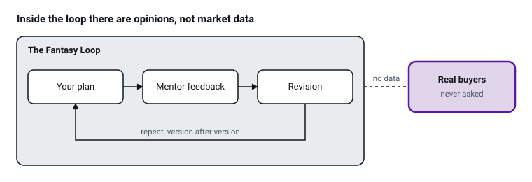
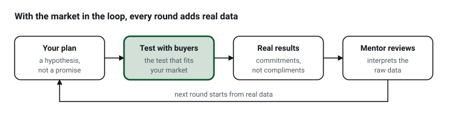

Most young founders I work with get feedback on their plans the same way: they build a strategy, say a model for landing their first clients, take it to a mentor, revise it and bring it back until everyone agrees it looks great. The problem is that through all of those rounds, not a single potential client has seen it, so the plan keeps getting better on paper without anyone checking it against the people it's supposed to win over. My hypothesis going in was that the more rounds a founder spends refining a plan with a mentor before testing it on real buyers, the more confident they feel and the less they actually know, so I went looking for what the research says.

## How often "no market need" actually kills a startup

Building something nobody wants isn't just a scary story; it's one of the most common reasons startups die, at least according to the founders who lived through it. [CB Insights](https://fortune.com/2014/09/25/why-startups-fail-according-to-their-founders/) collected post-mortems written by founders of failed startups, and in their analysis of 101 of them, 42% said there was no market need for what they built. In a [newer analysis](https://www.smartcompany.com.au/startupsmart/analysis/startups-fail-founders-capital/) of 111 post-mortems, it still ranked second at 35%, just behind running out of cash. These are founders explaining their own failures, so the numbers aren't perfect, but they point at the same thing: a lot of the time the idea itself was the problem, not how well it was pitched. That matters here because the only people who can tell you whether your idea has that problem are the buyers, and they're exactly who the mentor loop leaves out.

## What is the Fantasy Loop?

I call the pattern from the beginning the Fantasy Loop, because the plan only ever gets tested inside the conversation between the founder and the mentor. It goes in a circle: you bring the plan, the mentor gives feedback, you revise it, and the next meeting starts the whole thing again. Each round actually does make the plan more polished, and you usually learn something along the way, so it feels like progress. However, the market, which is the only party that can say whether the plan works, never gets a seat in that circle, so inside the loop there are plenty of opinions about your buyers but no data from them.

<figure>
  
  <figcaption>The Fantasy Loop · three steps, no buyer in the room</figcaption>
</figure>

If you follow the arrows, none of them ever leave the box. That's why version six of a plan can feel a lot better than version five while being exactly as unproven; the polish went up, but the evidence is still sitting at zero.

## What happens when a plan finally meets buyers

[Steve Blank](https://steveblank.com/2010/04/08/no-plan-survives-first-contact-with-customers/), who created the customer development method that the Lean Startup movement grew out of, has a well-known line about this: no business plan survives first contact with customers. In that post, he describes a team that spent four months putting together a 60-page business plan and found that at least half of their key assumptions were wrong within two weeks of talking to customers. Four months of careful work held up for less than two weeks once real people got involved, which says a lot about how far a plan can drift when the only people checking it are the ones who wrote it.

The research I found most convincing came from Bocconi University, where a group of researchers ran a [randomized controlled trial](https://pubsonline.informs.org/doi/10.1287/mnsc.2018.3249) with 116 startups. Both groups got the same startup training and the same mentor coaching sessions, but only one was taught to treat their ideas the way a scientist would, as hypotheses to test on the market, while the other was left to follow their intuition. The founders taught to test rigorously made more revenue and also pivoted more often, which makes sense, because they were finding out sooner when something wasn't working. A later [replication across 759 firms](https://iris.polito.it/retrieve/handle/11583/2995828/775581) found that the founders trained this way earned more revenue there too, and that they were more likely to drop their idea and did it sooner. In other words, the founders who treated their plans as something to prove with real buyers found out what was wrong while it was still cheap to fix. I know, revolutionary.

## Why smart founders stay in the loop anyway

It's hard to blame founders for staying in the loop, because when you look at what's going on in their heads, it makes a lot of sense. Part of it is how our brains handle hard questions. [Daniel Kahneman](https://en.wikipedia.org/wiki/Attribute_substitution) described something called attribute substitution, where, faced with a difficult question, we quietly answer an easier one without noticing we've made the swap. "Will strangers actually pay me for this?" is a hard and pretty scary question, while "Does my mentor like it?" is much easier, and it feels close enough that one starts standing in for the other.

[Paul Graham](https://paulgraham.com/before.html) has a name for a related habit, which he calls playing house: copying the rituals of a startup without the substance. Polishing the deck, debating strategy and collecting advice all look like startup work, and because you're busy and the plan keeps improving, nothing tells you to stop. However, none of it touches the one thing a startup actually has to prove, which is that someone will pay. Graham's point is that you don't need to be an expert in startups so much as an expert in your users, and the only place to get that is from your users.

Then there's the very human part. [Rob Fitzpatrick](https://www.momtestbook.com/), who wrote *The Mom Test*, says we fish for compliments because we crave approval, and a mentor's approval is usually the one that feels best to get. On top of that, we tend to give extra weight to advice from someone with status and experience, which is known as authority bias, so when a mentor signs off on a plan, the risk can feel like it's gone when really it's just been shared with someone who hasn't tested it either. And honestly, nobody likes hearing no; every revision pushes back the moment a real buyer could turn you down, which feels safe, but it also means the plan never gets a chance to succeed, because the only people who can say yes are the ones it's being kept away from.

## Now, your mentor isn't the problem

Now, none of this means you should drop your mentor, because most of them are giving the best advice they can. The issue is that inside the loop, even a great mentor is working with very limited information. Their experience comes from the markets they've worked in, at the time they worked in them, and they only ever see your market through you, filtered through what you happened to notice and what you were hoping to hear. Accelerators have noticed a version of this too; [Brad Feld](https://www.feld.com/archives/2013/06) has written that at Techstars they talk often about mentor whiplash, which is what happens when you get seemingly conflicting advice from multiple mentors.

If smart, experienced people can disagree about your plan, adding more opinions likely won't settle it, so the fix is to change what you bring to them. Before your next meeting, run one small test with real buyers and bring the results with you, which finally puts the market inside the loop.

<figure>
  
  <figcaption>The market loop · test first, then get advice</figcaption>
</figure>

Once you have real data, the conversation changes completely. Instead of asking "Does this sound good?", you get to ask "Here's what 30 buyers did, what am I missing?", and their experience goes toward interpreting what the market told you rather than guessing at what it might say. Even Fitzpatrick makes an exception for experts who have built very similar businesses, since their instincts are much closer to real market data, so if your mentor has done almost exactly what you're doing, their opinion deserves more weight, though I'd still test it.

## How to run your first market test

If I were starting from zero, I would fill in a short card before reaching out to anyone, since each line is a decision you need to make before the test starts:

1. **I believe** [specific buyer] will [specific action] because [reason].
2. **My test**, matched to how my buyer actually buys:
   - Software or app: a landing page or demo video with a signup
   - Physical product: list it before you stock it, and fill the first orders by hand
   - Service to businesses: direct outreach to 20 to 30 ideal clients
3. **What counts as a yes:** a commitment like money, time, a signup or a booked call. Someone saying "I'd totally buy that" doesn't count, which is the core rule of Rob Fitzpatrick's [The Mom Test](https://www.momtestbook.com/): compliments tell you very little, but commitments are evidence.
4. **I'm right if** [number] happens by [date].
5. **I'm wrong if** [number] by [date], and if that happens, I'll [change one thing, or drop the idea].
6. **What I bring my mentor:** the raw replies, objections word for word, and the numbers, rather than my own summary of them.

This works at any size, too. Before Dropbox was public, the team posted a demo video, and its beta waitlist went from 5,000 to 75,000 people overnight ([TechCrunch](https://techcrunch.com/2011/10/19/dropbox-minimal-viable-product/)). Zappos founder Nick Swinmurn started by asking a local shoe store if he could take pictures of its shoes and put them online, with a deal that if anyone ordered a pair, he'd buy it from the store at full price ([Fortune](https://fortune.com/2012/09/05/nick-swinmurn-zappos-silent-founder)). Both of them found out that people wanted what they were offering before spending real money building it, and while your test will look different depending on your product, the principle stays the same: build it around wherever your buyer actually makes decisions.

## Did the hypothesis hold up?

Mostly, yes: refining a plan with a mentor can make a founder feel more sure of it without making it any more proven. That matters because every round spent polishing an untested plan is time you could have spent finding out whether anyone wants it, and according to founders' own post-mortems, that's the problem founders blame for their failures more than almost anything else. Until a buyer has actually said yes or no, your plan is still a guess no matter how many times it's been reviewed, so before your next mentor meeting, run one small test and bring the raw results with you.

## Sources

- [Why startups fail, according to their founders](https://fortune.com/2014/09/25/why-startups-fail-according-to-their-founders/) (Fortune, on CB Insights' 101 post-mortems)
- [Startup founders give 12 reasons they think ventures fail](https://www.smartcompany.com.au/startupsmart/analysis/startups-fail-founders-capital/) (SmartCompany, on CB Insights' 111 post-mortems)
- [No Plan Survives First Contact With Customers](https://steveblank.com/2010/04/08/no-plan-survives-first-contact-with-customers/) (Steve Blank)
- [A Scientific Approach to Entrepreneurial Decision Making: Evidence from a Randomized Control Trial](https://pubsonline.informs.org/doi/10.1287/mnsc.2018.3249) (Camuffo, Cordova, Gambardella and Spina, Management Science)
- [Is There a Scientific Formula for Start-up Success?](https://knowledge.insead.edu/entrepreneurship/is-there-a-scientific-formula-for-start-up-success-15731) (INSEAD Knowledge, summary of the same trial)
- [A scientific approach to entrepreneurial decision-making: Large-scale replication and extension](https://iris.polito.it/retrieve/handle/11583/2995828/775581) (Camuffo et al.)
- [Attribute substitution](https://en.wikipedia.org/wiki/Attribute_substitution) (Kahneman and Frederick's theory)
- [Before the Startup](https://paulgraham.com/before.html) (Paul Graham)
- [The Mom Test](https://www.momtestbook.com/) (Rob Fitzpatrick)
- [Mentor Whiplash About Early Board Members](https://www.feld.com/archives/2013/06) (Brad Feld, June 2013)
- [How Dropbox started as a minimal viable product](https://techcrunch.com/2011/10/19/dropbox-minimal-viable-product/) (TechCrunch)
- [Nick Swinmurn, Zappos' silent founder](https://fortune.com/2012/09/05/nick-swinmurn-zappos-silent-founder) (Fortune)
