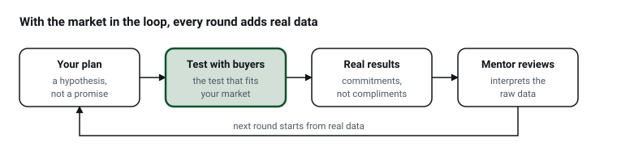

When I work with young founders, there's a pattern I keep running into. Someone builds a strategy, say a model for landing their first clients, and takes it to a mentor for feedback. The mentor has good notes, so the founder goes back, revises it and brings it in again, and after a few rounds the plan looks great and everyone feels good about it. The part that started to bother me is that through all of those rounds, not a single potential client has seen it. The founder and the mentor end up building a kind of fantasy world together, where the plan keeps getting better on paper without anyone checking it against the people it's supposed to win over.

That made me wonder how much this actually costs founders, so I went looking for what the research says. This led me to my hypothesis: the more rounds a founder spends refining a plan with a mentor before testing it on real buyers, the more confident they feel and the less they actually know.

## How often does "no market need" actually sink a startup?

The first thing I wanted to know was whether building something nobody wants is a real problem or just a scary story people like to tell. It turns out it's one of the most common reasons startups die, at least according to the founders themselves. [CB Insights](https://fortune.com/2014/09/25/why-startups-fail-according-to-their-founders/) collected post-mortems written by founders of failed startups, and in their analysis of 101 of them, 42% said there was no market need for what they built. When they ran a [newer analysis](https://www.smartcompany.com.au/startupsmart/analysis/startups-fail-founders-capital/) of 111 post-mortems, it still ranked second at 35%, just behind running out of cash. These are founders explaining their own failures, so the numbers aren't perfect, but it's hard to look at them and not notice how often the problem was the idea itself rather than how well it was pitched. And the only people who can tell you whether your idea has that problem are the buyers.

## What is the Fantasy Loop?

I've started calling the pattern from the beginning the Fantasy Loop, because the plan only ever gets tested inside the conversation between the founder and the mentor. It goes in a circle: the founder brings the plan, the mentor gives feedback, the founder revises it, and the next meeting starts the whole thing again. Each round really does make the plan more polished, and the founder usually learns something along the way, so it feels like progress. The catch is that the market, which is the only party that can actually say whether the plan works, never gets a seat in that circle. Inside the loop there are plenty of opinions about the market, but no data from it.

<figure>
  
  <figcaption>The Fantasy Loop · three steps, no market contact</figcaption>
</figure>

If you follow the arrows in the diagram, you'll notice that none of them ever leave the box. That's why version six of a plan can feel a lot better than version five while being no more proven than it was before.

## What happens when a plan finally meets customers?

[Steve Blank](https://steveblank.com/2010/04/08/no-plan-survives-first-contact-with-customers/), who created the customer development method that the Lean Startup movement grew out of, has a well-known line about this: no business plan survives first contact with customers. In that post he describes a team that spent four months putting together a 60-page business plan. Within two weeks of actually talking to customers, they found that at least half of their key assumptions were wrong. Four months of careful work held up for less than two weeks once real people got involved, and I think that says a lot about how far a plan can drift when the only people checking it are the ones who wrote it.

The research I found most convincing came from a group of researchers at Bocconi University, who ran a [randomized controlled trial](https://pubsonline.informs.org/doi/10.1287/mnsc.2018.3249) with 116 startups. They trained one group of founders to treat their ideas the way a scientist would, as hypotheses to test on the market, while the other group kept running on intuition. The founders who tested performed better, and they also pivoted more often, which makes sense when you think about it, because they were finding out sooner when something wasn't working. A later [replication across 759 firms](https://iris.polito.it/retrieve/handle/11583/2995828/775581) found something similar and added that the founders who tested also dropped bad ideas faster. To put it more simply: the founders who checked their ideas with real buyers found out what was wrong while it was still cheap to fix.

## Why do so many founders stay in the loop anyway?

Once I saw the evidence, the question I got more curious about was why so many smart founders stay in the loop anyway. It's hard to blame them, because when you look at what's going on in their heads, staying in the loop makes a lot of sense.

Part of it is how our brains handle hard questions. [Daniel Kahneman](https://en.wikipedia.org/wiki/Attribute_substitution) described something called attribute substitution, where, faced with a difficult question, we quietly answer an easier one instead without noticing we've made the swap. "Will strangers actually pay me for this?" is a hard and pretty scary question. "Does my mentor like it?" is much easier, and it feels close enough that it's easy to treat one as the answer to the other.

[Paul Graham](https://paulgraham.com/before.html) has a name for a related habit, which he calls playing house: copying the rituals of a startup without the substance. Polishing the deck, debating strategy and collecting advice all look like startup work, and that's exactly why it's so easy to get stuck there, because you're busy and the plan keeps improving, so nothing tells you to stop. But none of it touches the one thing a startup actually has to prove, which is that someone will pay. Graham's point is that you don't need to be an expert in startups; you need to be an expert in your users, and the only place to get that is from your users.

Then there's the very human part. [Rob Fitzpatrick](https://www.momtestbook.com/), who wrote *The Mom Test*, says founders fish for compliments because they want approval from people they respect, and a mentor is usually exactly that kind of person. Hearing "this is really coming together" feels like validation, but an opinion is still an opinion, and you can grow a business only on people who actually buy. On top of that, we tend to give extra weight to advice from someone with status and experience, which is known as authority bias. So when a mentor signs off on a plan, the risk can feel like it's gone, when really it's just been shared with someone who hasn't tested it either.

It's also hard to ignore the simple fact that nobody likes hearing no. Every time a founder revises the plan instead of testing it, they push back the moment a real buyer could turn them down. That feels safe in the moment, but it also means the plan never gets the chance to succeed, because the only people who can say yes are the ones it's being kept away from. What all of these have in common is that they make a plan feel safer without making it any more likely to work, and until a buyer has actually said yes or no, the plan is still a guess no matter how many times it's been reviewed.

## Can a mentor even tell whether their advice fits your market?

I want to be fair to mentors here, because most of them are giving the best advice they can. The issue is that inside the loop, even a great mentor is working with very limited information. Their experience comes from the markets and customers they've worked with, at the time they worked with them, and those might be very different from yours. Early on, you usually don't know your own market well enough to judge whether their advice fits it either, so it's hard to tell good advice apart from advice that just sounds confident.

There's a second problem that I think is easy to miss. Your mentor only ever sees your market through you, and you can't help filtering what you tell them through what you happened to notice and what you were hoping to hear. They give advice based on that filtered version, and then your next update carries both your assumptions and theirs. It works a bit like the telephone game, where the message drifts a little further from where it started every round, and in this case it drifts further away from the real buyer.

<figure>
  
  <figcaption>The telephone game · how bias compounds each round</figcaption>
</figure>

Accelerators have noticed a version of this too. [Brad Feld](https://feld.com/page/11/?s=mentors) has written about what Techstars calls mentor whiplash, which is when several experienced mentors give a founder conflicting advice about the same plan. If smart, experienced people can disagree about your plan, adding more opinions probably won't settle it, and the best way to find out who's right is to ask the people you're trying to sell to.

## So what should a founder do instead?

None of this means you should drop your mentor. What I'd suggest is changing what you bring to them: before your next meeting, run one small test with real buyers and bring the results with you. That way the loop finally includes the market, and the diagram below shows what that looks like.

<figure>
  
  <figcaption>The market loop · test first, then get advice</figcaption>
</figure>

### A simple card for your first market test

To make this easier, I put together a short card you can fill in before you reach out to anyone. This is one of the few places where a list really helps, since each line is a decision you need to make before the test starts.

1. **I believe** [specific buyer] will [specific action] because [reason].
2. **My test**, matched to how my buyer actually buys:
   - Software or app: a landing page or demo video with a signup
   - Physical product or e-commerce: list it before you stock it, and fill the first orders by hand
   - Services to businesses: direct outreach to 20 to 30 ideal clients
3. **What counts as a yes:** a commitment rather than a compliment, like money, time, a signup or a booked call. Someone saying "I'd totally buy that" doesn't count, and that's [Fitzpatrick](https://www.momtestbook.com/)'s core rule: compliments don't tell you much, but commitments are evidence.
4. **I'm right if** [number] happens by [date].
5. **I'm wrong if** [number] by [date], and if that happens, I'll [change one thing, or drop the idea].
6. **What I bring my mentor:** the raw replies, objections word for word, and the numbers, rather than my own summary of them.

This works at any size, too. Before Dropbox was public, the team posted a demo video, and its waitlist jumped from 5,000 to 75,000 people overnight ([TechCrunch](https://techcrunch.com/2011/10/19/dropbox-minimal-viable-product/)). Zappos's founder took photos of shoes in local stores and listed them online, and he only bought each pair after someone had ordered it ([ICMR](https://www.icmrindia.org/Casestudies/catalogue/Human%20Resource%20and%20Organization%20Behavior/Holacracy%20at%20Zapposs-Case%20Study.htm)). Both of them found out that people wanted what they were offering before they spent real money building it.

## Where does the mentor fit in?

Once you have real data, this is where a mentor becomes really valuable. Instead of asking "Does this sound good?", you can say "Here's what 30 buyers did, what am I missing?", and that changes the whole conversation. Their experience now goes toward interpreting what the market told you rather than guessing at what it might say, and I think that's where it's worth the most. It's also worth knowing that even Fitzpatrick makes an exception for experts who have built very similar businesses, since their instincts are much closer to real market data. So if your mentor has done almost exactly what you're doing, their opinion deserves more weight, though I'd still test it.

## So what?

My hypothesis mostly held up: refining a plan with a mentor can make a founder feel more sure of it without making it any more proven. That matters because every round spent polishing an untested plan is time you could have spent finding out whether anyone wants it, and that's the question that sinks the most startups. If I had to boil this down for a young founder, here's what I'd want them to take away:

- A plan that only you and your mentor have reviewed is still a guess, no matter how polished it looks.
- Before your next mentor meeting, run one small test with real buyers, and count commitments like money, signups or booked calls rather than compliments.
- Bring your mentor the raw results instead of your summary, because that's when their experience is most useful.

## Sources

- [Why startups fail, according to their founders](https://fortune.com/2014/09/25/why-startups-fail-according-to-their-founders/) (Fortune, on CB Insights' 101 post-mortems)
- [Startup founders give 12 reasons they think ventures fail](https://www.smartcompany.com.au/startupsmart/analysis/startups-fail-founders-capital/) (SmartCompany, on CB Insights' 111 post-mortems)
- [No Plan Survives First Contact With Customers](https://steveblank.com/2010/04/08/no-plan-survives-first-contact-with-customers/) (Steve Blank)
- [A Scientific Approach to Entrepreneurial Decision Making: Evidence from a Randomized Control Trial](https://pubsonline.informs.org/doi/10.1287/mnsc.2018.3249) (Camuffo, Cordova, Gambardella and Spina, Management Science)
- [A scientific approach to entrepreneurial decision-making: Large-scale replication and extension](https://iris.polito.it/retrieve/handle/11583/2995828/775581) (Camuffo et al.)
- [Attribute substitution](https://en.wikipedia.org/wiki/Attribute_substitution) (Kahneman and Frederick's theory)
- [Before the Startup](https://paulgraham.com/before.html) (Paul Graham)
- [The Mom Test](https://www.momtestbook.com/) (Rob Fitzpatrick)
- [Mentor whiplash](https://feld.com/page/11/?s=mentors) (Brad Feld)
- [How Dropbox started as a minimal viable product](https://techcrunch.com/2011/10/19/dropbox-minimal-viable-product/) (TechCrunch)
- [Holacracy at Zappos case study](https://www.icmrindia.org/Casestudies/catalogue/Human%20Resource%20and%20Organization%20Behavior/Holacracy%20at%20Zapposs-Case%20Study.htm) (ICMR)
