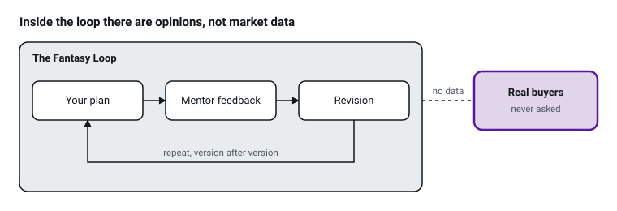
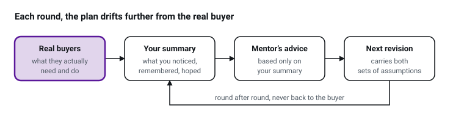

## Nobody wanted it

For over a decade, founders' own post-mortems have ranked "no market need" at or near the top of why their startups died. [CB Insights](https://fortune.com/2014/09/25/why-startups-fail-according-to-their-founders/) found 42% of 101 failed startups cited it. Their [newer analysis](https://www.smartcompany.com.au/startupsmart/analysis/startups-fail-founders-capital/) of 111 still ranks it second at 35%, right behind running out of cash.

Read that again. The most common way to fail isn't a bad pitch. It's selling something nobody wanted, and only buyers can tell you whether that's you.

So here's the uncomfortable question: if your mentor has seen version five of your plan and no customer has seen version one, how would you know?

## The trap: the Fantasy Loop

**The Fantasy Loop** is refining your plan through round after round of mentor feedback without ever testing it on real buyers.

- Every round makes the plan more polished. None of them makes it more true.
- The loop is closed: plan, feedback, revision, feedback again.
- The market, the only party that can say whether it works, sits outside it.
- Inside the loop there are opinions about the market. There's no data from it.

<figure>
  
  <figcaption>The Fantasy Loop · three steps, no market contact</figcaption>
</figure>

Every arrow stays inside the box. Version six will feel better than version five. It won't be any more proven.

## The proof: plans that skip the market break

- **The First Contact Rule.** [Steve Blank](https://steveblank.com/2010/04/08/no-plan-survives-first-contact-with-customers/), creator of the customer development method behind the Lean Startup movement, says it flatly: no business plan survives first contact with customers. He describes a team that spent four months on a 60-page plan. Within two weeks of talking to customers, at least half their key assumptions were wrong.
- **The Scientist Advantage.** In a [randomized controlled trial](https://pubsonline.informs.org/doi/10.1287/mnsc.2018.3249) of 116 startups, Bocconi University researchers trained one group to treat ideas as hypotheses and test them on the market. That group performed better and pivoted more than founders running on intuition. A [replication across 759 firms](https://iris.polito.it/retrieve/handle/11583/2995828/775581) found testers also killed bad ideas faster.
- **The Market-Need Graveyard.** That's the CB Insights data from the top. "No market need" isn't bad luck. It's an assumption that stayed untested for too long.

Polishing a plan tells you nothing about whether it's right. Contact with buyers does.

## Why you keep doing it anyway

This isn't laziness. It's your brain protecting you. Five forces keep you in the loop:

- **Attribute Substitution.** [Daniel Kahneman](https://en.wikipedia.org/wiki/Attribute_substitution) showed that when a question is hard, your brain quietly answers an easier one instead. "Will strangers pay me?" is hard and scary. "Does my mentor like it?" is easy. Guess which one you're working on.
- **Playing House.** [Paul Graham](https://paulgraham.com/before.html)'s name for founders who copy the rituals of a startup without the substance: polishing the deck, debating strategy, collecting advice. It's dangerous because it feels exactly like progress. You're busy, you're learning, and the plan keeps improving, so nothing tells you to stop. But none of it touches the one thing a startup has to prove: that someone will pay. Graham's point is that you don't need expertise in startups. You need expertise in your users, and you only get that from your users.
- **Approval Seeking.** [Rob Fitzpatrick](https://www.momtestbook.com/), author of *The Mom Test*, says founders fish for compliments because they crave approval from people they respect. "This is really coming together" feels like validation. It isn't. An opinion is not a sale, and it is not data. You can't build growth on approval. You can only build it on people who actually buy.
- **Authority Bias.** People give extra weight to advice from someone with status and experience. When your mentor signs off, the risk feels gone. It isn't. You've just shared it with someone who hasn't tested it either.
- **Rejection Avoidance.** Every revision delays the moment a real person can say no. A plan that never leaves the loop can't fail. It can't succeed either.

**The bottom line:** none of these forces make your plan better. They only make it feel safer. Until a buyer has said yes or no, your plan is a guess, no matter how many times it has been reviewed.

## The two blind spots no mentor can fix

Even a great mentor is flying blind in this loop.

- **The Unverifiable Advice Problem.** You don't know your market well enough yet to judge whether your mentor's advice fits it. Their experience comes from ***their*** markets, ***their*** customers, ***their*** timing. Not yours. Without data, you can't tell good advice from advice that just sounds confident.
- **The Telephone Game.** Your mentor only sees your market through you. You filter what you report: what you noticed, what you remembered, what you hoped. They advise on that filtered version, and your next summary carries both sets of assumptions. Every round, the plan drifts further from the real buyer.

<figure>
  
  <figcaption>The telephone game · how bias compounds each round</figcaption>
</figure>

- **Mentor Whiplash.** Accelerators like Techstars already have a name for experienced mentors giving a founder conflicting advice ([Brad Feld](https://feld.com/page/11/?s=mentors)). If smart people can disagree about your plan, more opinions won't settle it. Only buyers can.

## The fix: put buyers inside the loop

Keep your mentor. Change what you bring them. Before your next meeting, run one test with real buyers.

<figure>
  
  <figcaption>The market loop · test first, then get advice</figcaption>
</figure>

### The Market Test Card

Copy this. Fill in every line before you send a single message.

1. **I believe** [specific buyer] will [specific action] because [reason].
2. **My test**, matched to how my buyer actually buys:
   - Software or app: a landing page or demo video with a signup
   - Physical product or e-commerce: list it before you stock it, and fill the first orders by hand
   - Services to businesses: direct outreach to 20 to 30 ideal clients
3. **What counts as a yes:** a commitment, not a compliment. Money, time, a signup, a booked call. "I'd totally buy that" is not a yes. That's [Fitzpatrick](https://www.momtestbook.com/)'s core rule: compliments are worthless, commitments are evidence.
4. **I'm right if** [number] happens by [date].
5. **I'm wrong if** [number] by [date]. Then I'll [change one thing, or kill it].
6. **What I bring my mentor:** the raw replies, objections word for word, and the numbers. Not my summary.

This works at any size. Dropbox posted a demo video before the product was public, and its waitlist jumped from 5,000 to 75,000 overnight ([TechCrunch](https://techcrunch.com/2011/10/19/dropbox-minimal-viable-product/)). Zappos's founder photographed shoes in local stores and listed them online, buying each pair only after someone ordered it ([ICMR](https://www.icmrindia.org/Casestudies/catalogue/Human%20Resource%20and%20Organization%20Behavior/Holacracy%20at%20Zapposs-Case%20Study.htm)). Both proved demand before building anything.

## Where your mentor actually earns their keep

Mentors aren't the problem. Mentors without data are.

- Bring raw evidence, not your interpretation of it.
- Stop asking "Does this sound good?" Ask "Here's what 30 buyers did. What am I missing?"
- Now their experience interprets the market instead of guessing at it. That's where it's worth the most. Even Fitzpatrick makes an exception for experts who have built very similar businesses.

## The bottom line

- **Mentors check logic. Markets check reality.**
- **Every revision without data adds bias.**
- **Advice multiplies data. It can't replace it.**

## Sources

- [Why startups fail, according to their founders](https://fortune.com/2014/09/25/why-startups-fail-according-to-their-founders/) (Fortune, on CB Insights' 101 post-mortems)
- [Startup founders give 12 reasons they think ventures fail](https://www.smartcompany.com.au/startupsmart/analysis/startups-fail-founders-capital/) (SmartCompany, on CB Insights' 111 post-mortems)
- [No Plan Survives First Contact With Customers](https://steveblank.com/2010/04/08/no-plan-survives-first-contact-with-customers/) (Steve Blank)
- [A Scientific Approach to Entrepreneurial Decision Making: Evidence from a Randomized Control Trial](https://pubsonline.informs.org/doi/10.1287/mnsc.2018.3249) (Camuffo, Cordova, Gambardella and Spina, Management Science)
- [A scientific approach to entrepreneurial decision-making: Large-scale replication and extension](https://iris.polito.it/retrieve/handle/11583/2995828/775581) (Camuffo et al.)
- [Attribute substitution](https://en.wikipedia.org/wiki/Attribute_substitution) (Kahneman and Frederick's theory)
- [Before the Startup](https://paulgraham.com/before.html) (Paul Graham)
- [The Mom Test](https://www.momtestbook.com/) (Rob Fitzpatrick)
- [Mentor whiplash](https://feld.com/page/11/?s=mentors) (Brad Feld)
- [How Dropbox started as a minimal viable product](https://techcrunch.com/2011/10/19/dropbox-minimal-viable-product/) (TechCrunch)
- [Holacracy at Zappos case study](https://www.icmrindia.org/Casestudies/catalogue/Human%20Resource%20and%20Organization%20Behavior/Holacracy%20at%20Zapposs-Case%20Study.htm) (ICMR)
